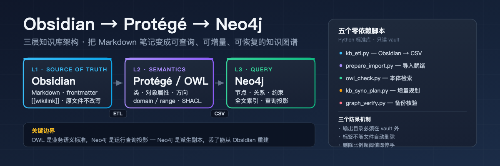

<p align="center">
  
</p>

# Obsidian → Protégé → Neo4j 三层知识库架构

> 把 Obsidian 里的 Markdown 笔记，变成**可查询、可增量更新、可恢复**的本地知识图谱。
> 五个零依赖 Python 脚本 + 一份实战沉淀的 SKILL.md，源自真实跑通的本地工程。

[](https://www.python.org/)
[](LICENSE)
[](https://neo4j.com/)
[](https://www.w3.org/TR/owl2-overview/)
[](https://pypi.org/)

---

## 为什么要分三层

很多人在 Obsidian 里遇到同一个问题：**明明写过，为什么找一条相关经验还要翻半天？**

根因不是笔记少，而是**文件、标签和 `[[链接]]` 分散着，没法一次问清"这张卡归哪个主题、它又指向哪些卡"**。

单靠 Obsidian 搜索，你只能拿到"文本匹配"。想要"这张卡归哪个主题 → 它指向哪些卡 → 那些卡又和什么有关"，你需要一张**图**。

但直接上图数据库会踩一堆坑。所以这个方案把职责拆开：

| 层 | 组件 | 存什么 | 绝不做的事 |
|---|---|---|---|
| **L1 事实源** | Obsidian Vault | 原始 Markdown、frontmatter、`[[wikilink]]` | ❌ 不被任何脚本改写 |
| **L2 语义层** | Protégé / OWL | 类、对象属性、domain/range、SHACL 约束 | ❌ 不存实例数据，不手工拖入几万个文件 |
| **L3 查询层** | Neo4j | 节点、边、约束、索引、全文索引 | ❌ 不是事实源，丢了能从 L1 重建 |

> **关键边界**：OWL 本体是业务语义标准，Neo4j 是运行查询投影。两者通过稳定的类/属性/关系标识映射，**不要求把全部 OWL 公理搬进 Neo4j**。
>
> 因为 Neo4j 是**派生副本**，你才敢在图上做任何实验——图谱整个删掉，笔记纹丝不动。

---

## 这个仓库里有什么

### 五个零依赖脚本（只用 Python 标准库）

| 脚本 | 作用 | 关键设计 |
|---|---|---|
| `kb_etl.py` | Obsidian → `nodes.csv` / `relationships.csv` | ID 用相对路径不用标题；歧义链接报错不猜；输出目录必须在 vault 外 |
| `prepare_import.py` | CSV → Neo4j 离线导入就绪 | 补 `id` 属性 + `KBNode` 标签；校验 ID 唯一与端点存在 |
| `owl_check.py` | OWL/Turtle 本体检索 | 数类、数对象属性、解析 domain/range、给告警 |
| `kb_sync_plan.py` | 增量同步规划 | 只读规划 ADD/UPDATE/DELETE；标签不自动删；删除超阈值即停 |
| `graph_verify.py` | 备份完整性核验 | A 级结构核验，明确声明**不等于**灾难恢复 |

### 四份实战参考

- `references/ontology-design.md` — 本体设计：类树、关系方向、SHACL 约束、OWL↔Cypher 映射
- `references/etl-and-import.md` — ETL 与离线导入细节、常见报错对照表
- `references/sync-and-backup.md` — 增量同步归属模型、停手线、两级恢复验证
- `references/security-boundaries.md` — 脱敏红线、权限过滤顺序、审计表述纪律

### 两份模板

- `templates/ontology-minimal.ttl` — 可直接在 Protégé 打开的最小本体（7 类 / 6 关系 / SHACL）
- `templates/node-labeling.md` — 节点 ID 与标签命名规范

---

## 快速开始

### 0️⃣ 先跑通三张假笔记

**绝不用整库冒险。** 仓库里带了三张完全虚构的演示笔记：

```bash
git clone https://github.com/zhoudibo/obsidian-protege-neo4j.git
cd obsidian-protege-neo4j

# ETL（先 dry-run 看数量）
python3 skills/obsidian-protege-neo4j/scripts/kb_etl.py \
  --vault ./demo_vault --out ./demo_out --dry-run
# files=3 nodes=7 relationships=10 wikilink=3 tags=3

python3 skills/obsidian-protege-neo4j/scripts/kb_etl.py \
  --vault ./demo_vault --out ./demo_out

# 准备 Neo4j 离线导入
python3 skills/obsidian-protege-neo4j/scripts/prepare_import.py \
  ./demo_out ./demo_ready
# PASS nodes=7 relationships=10; id property and KBNode label present

# 核验本体
python3 skills/obsidian-protege-neo4j/scripts/owl_check.py \
  ./skills/obsidian-protege-neo4j/templates/ontology-minimal.ttl
# classes: 7 / obj props: 6 / WARNINGS: none
```

### 1️⃣ 在 Protégé 里建模

新建 OWL ontology → Classes 页建类树 → Object properties 页建关系**并写明 domain/range** → 保存 `.owl`/`.ttl`。

最小起步集：

```
类    : Document, IndexCard, Directory, Tag
关系  : CONTAINS      (Directory → Document)
        LINKS_TO      (IndexCard → Document)
        TAGGED_WITH   (Document → Tag)
```

验收别只看"文件能打开"。抽一张索引卡、一张普通笔记、一张附件，问三个问题：
**类别对吗？关系方向对吗？同名文件 ID 还唯一吗？** 不对就先改模型——本体改一次是一小时，灌完再改是重来。

### 2️⃣ 灌进 Neo4j（全新空库）

```bash
# ⚠️ 参数随 Neo4j 版本变化，以本机 --help 为准
neo4j-admin database import full \
  --nodes-dir=demo_ready --relationships-dir=demo_ready \
  --nodes=nodes.csv --relationships=relationships.csv
```

启动后在 Browser 立刻核两句：

```cypher
MATCH (n:KBNode) RETURN count(n) AS nodes;
MATCH ()-[r]->() RETURN count(r) AS relationships;
MATCH (a:IndexCard)-[:LINKS_TO]->(b) RETURN a.title, b.title LIMIT 10;
```

第三句是"是否真能按关系查"的验证。只跑前两句，图里全是孤岛也算"成功"。

### 3️⃣ 每日增量同步

```bash
python3 skills/obsidian-protege-neo4j/scripts/kb_sync_plan.py \
  --vault ./demo_vault --graph-state ./graph_nodes.json
```

```
scanned: files=3 dirs=1 tags=3
graph  : 9 nodes
ADD    : 0
UPDATE : 0
DELETE : 1 (ratio=0.2, volume_drop=0.2)
TAGS   : 1 orphan tags kept (not auto-deleted)
SAFETY : ok
```

---

## 五个真踩过的坑

### 坑 1：`:ID` 不是属性，`id` 才是

Neo4j 离线导入的 `:ID` 列只用于**导入时匹配关系端点**，它**不会**存成节点属性。

如果日更脚本用 `MERGE (n:KBNode {id: $id})` 找节点，而节点上只有 `:ID` 没有 `id`，那 MERGE **永远匹配不到**——每次同步都新建节点，图谱越滚越大；或者错误回收旧节点。

`prepare_import.py` 就干这件事：保留 `:ID`、**额外写入普通 `id` 属性**、给所有节点加 `KBNode` 标签。

> 这是整条链路里最常被跳过、后果最严重的一步。修好后必须测：**同一输入跑两次，节点数不增加**。

### 坑 2：标签不能随文件一起删

早期实现把"本轮没扫描到的节点"直接删掉，**差点把未变更但仍被引用的标签一起清掉**。

正确归属模型：

| 节点类型 | 归属 | 删除策略 |
|---|---|---|
| 文件 / 目录 | vault（内容哈希跟踪） | vault 中消失才可删 |
| 标签 `tag:*` | **不属于任何文件** | 仅回收**无入边**的孤儿标签 |
| 源系统 `source:*` | 流水线 | **永不自动删** |

### 坑 3：标题会撞，路径不会

每个目录都有 `00_索引.md`。用标题做 ID，几个目录的索引卡就合并成一个节点了。

**ID 用 vault 内相对路径。** 代价是改名/移动会改变 ID，所以同步要按"旧 ID 删除 + 新 ID 建立"处理。

### 坑 4：输出目录放在 vault 里，图谱会自我吞噬

ETL 的输出必须在 vault **外面**。否则下次扫描把上次的 `nodes.csv` 当笔记读进去。

```python
if out == vault or vault in out.parents:
    raise ValueError('output directory must be OUTSIDE the vault')
```

### 坑 5：备份"存在"不等于"能恢复"

必须把结论分成两级写，**不能混**：

| 层级 | 动作 | 能得出什么 |
|---|---|---|
| **A 级：导出完整性** | 读 JSON 核节点 ID / 关系端点 / 计数；核 bundle 可打开 | 备份文件**结构可信** |
| **B 级：隔离恢复** | 空库或另一台机器导入备份 + 跑固定查询 + 抽查原卡 | 灾难恢复**成功** |

只做了 A 级，报告里**不能写"恢复成功"**。

还有两个容易被忽略的缺口：**Git bundle 不含未跟踪附件**；**同机备份不抵御整盘损坏**。

---

## 安全边界（不可协商）

- **Obsidian 原文件是事实源**，任何导入脚本不得改写源文件
- 公开/共享图谱：**先用副本试跑**，列出排除规则（脚本支持 `--exclude`）
- 不把身份证、银行卡、完整联系方式、生产密钥、未脱敏原文写入图数据库
- 原始合同、图纸、照片留在对象存储，图库只存**来源指针**
- **权限过滤必须先于召回和生成**——反过来做，模型可能已经"看见"了无权内容
- 审计报告**只报"命中位置与条数"，绝不写密码原文**
- 不靠"图上不点开"来保护私密内容——那是技术问题，不是纪律问题

---

## 常见失败模式速查

| 症状 | 根因 | 对策 |
|---|---|---|
| 增量同步后节点暴涨 | 只有 `:ID` 无 `id` 属性 | `prepare_import.py` 补 `id` + `KBNode` |
| 标签被误删 | 用"没扫描到"当删除依据 | 只回收无入边孤儿标签 |
| 同名文件互相覆盖 | 用标题做 ID | 用 vault 相对路径 |
| 下次扫描吃到自己 | 输出目录在 vault 内 | 输出必须在 vault 外 |
| 关系方向全反 | 本体没写 domain/range | Protégé 里补齐并用 `owl_check.py` 核验 |
| 恢复演练做不出来 | 只做了 A 级完整性 | 隔离库导入 + 固定查询才算 B 级 |
| 体检脚本报 `'password'` | 脚本未跟随凭据迁移 | 同步改脚本的配置读取方式 |

---

## 目录结构

```
obsidian-protege-neo4j/
├── README.md / README_EN.md
├── LICENSE                          MIT
├── assets/banner.svg / banner.png
├── demo_vault/                      三张虚构演示笔记
├── docs/real-world-lessons.md       实战踩坑全记录
└── skills/obsidian-protege-neo4j/
    ├── SKILL.md                     Hermes Skill 主文件
    ├── scripts/                     五个零依赖脚本
    ├── references/                  四份实战参考
    └── templates/                   本体与命名模板
```

---

## 作为 Hermes Skill 使用

```bash
# 克隆到 skills 目录
git clone https://github.com/zhoudibo/obsidian-protege-neo4j.git \
  ~/.hermes/skills/obsidian-protege-neo4j
```

`SKILL.md` 会在涉及以下场景时自动触发：把 vault 变成图谱、设计 OWL 本体、生成 Neo4j 导入 CSV、规划增量同步、核验图谱备份。

触发词：`Obsidian 知识图谱`、`Protégé`、`OWL 本体`、`Neo4j 灌库`、`知识图谱同步`、`vault to graph`、`ontology to Neo4j`。

---

## FAQ

**Q：一定要装 Protégé 吗？**
不是必须。Protégé 是 GUI 建模器，最适合画类树和填 domain/range。但**验证必须在文件上做**——`owl_check.py` 数出"13 个类、8 类对象关系"是证据，Protégé 窗口截图不是。一致性检查（HermiT / ELK）可以再装 reasoner。

**Q：为什么不用 Neo4j 在线写入，而要用离线导入？**
在线逐条写几万个节点要几十分钟，`neo4j-admin database import full` 是分钟级。代价是必须停实例、且目标是空库。

**Q：图谱建好了，Obsidian 还需要吗？**
必须。Obsidian 是事实源，图是派生副本。这个顺序不能反——反了就变成"图谱是唯一副本"，任何一次同步 bug 都是灾难。

**Q：能不能直接连 Neo4j 增量 MERGE，不走 CSV？**
可以，但那样就丢掉了"先在离线环境验证 CSV"的保护。这个方案刻意保留 CSV 中转，因为它可 diff、可审计、可重放。

**Q：Windows 上能用吗？**
可以，脚本纯标准库。但注意：路径分隔符要归一化成 `/`，否则生成的 ID 在不同系统上不一致。

---

## 适用场景

- ✅ 个人知识库从"文本搜索"升级到"关系检索"
- ✅ 整理多年积累的 Markdown 归档
- ✅ 企业文档中心的图谱化试点（ERP / OA / 文档中心 → Neo4j）
- ✅ GraphRAG 的前置图谱层
- ✅ 需要把 OWL 本体规范落到可运行数据库的团队

**不适用**：单纯需要全文检索（用 Obsidian 自带搜索 + 插件即可）；笔记量在几百篇以内（还没到需要图的规模）。

---

## 搜索关键词

`Obsidian 知识图谱` · `Obsidian Neo4j` · `Protégé OWL 本体` · `vault to neo4j` ·
`知识图谱 ETL` · `Neo4j 离线导入` · `OWL SHACL 约束` · `Obsidian 增量同步` ·
`知识图谱 备份恢复` · `Obsidian vault graph database`

---

## 更新日志

| 版本 | 日期 | 变更 |
|---|---|---|
| v1.0.0 | 2026-11-03 | 首个公开版本。5 个零依赖脚本、4 份实战参考、2 份模板、三张虚构演示笔记。 |

---

## 参考

- [Neo4j 离线全量导入](https://neo4j.com/docs/operations-manual/current/import/full-import/)
- [Neo4j Community 离线备份限制](https://neo4j.com/docs/operations-manual/current/backup-restore/offline-backup/)
- [Stanford Protégé 本体建模教程](https://protege.stanford.edu/publications/ontology_development/ontology101.pdf)
- [W3C SHACL 约束](https://www.w3.org/TR/shacl/)
- [W3C OWL 2 Primer](https://www.w3.org/TR/owl2-primer/)

## License

MIT © zhoudibo
