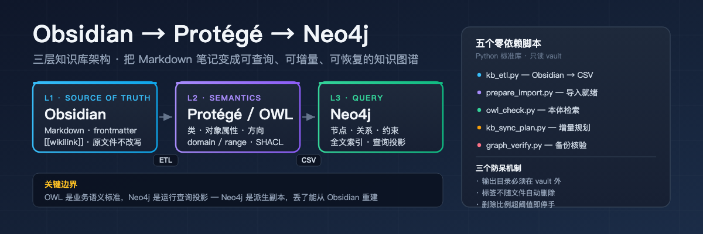

<p align="center">
  
</p>

# Obsidian → Protégé → Neo4j

> Turn a folder of Markdown notes in Obsidian into a **queryable, incrementally synced, recoverable** local knowledge graph.
> Five zero-dependency Python scripts and a battle-tested SKILL.md, distilled from a real local engineering project.

[](https://www.python.org/)
[](LICENSE)
[](https://neo4j.com/)
[](https://www.w3.org/TR/owl2-overview/)
[](https://pypi.org/)

[中文文档](README.md) · [Report an issue](https://github.com/zhoudibo/obsidian-protege-neo4j/issues)

---

## The problem

You wrote it down. Now you cannot find it.

Obsidian search gives you **text matching**. What you actually want is *"which topic does this card belong to, what does it point at, and what do those cards relate to"* — that is a **graph** query.

Going straight to a graph database is where things break. This repo splits the responsibilities so each layer stays honest:

| Layer | Component | Holds | Never does |
|---|---|---|---|
| **L1 Source of truth** | Obsidian Vault | Raw Markdown, frontmatter, `[[wikilinks]]` | ❌ Never rewritten by a script |
| **L2 Semantics** | Protégé / OWL | Classes, object properties, domain/range, SHACL shapes | ❌ No instance data; never hand-drag 40k files |
| **L3 Query** | Neo4j | Nodes, edges, constraints, indexes, fulltext | ❌ Not the source of truth — rebuildable from L1 |

> **The boundary that matters**: the OWL ontology is the business-semantics standard; Neo4j is the runtime query projection. They map through stable class/property/relationship identifiers — you do **not** need to copy every OWL axiom into Neo4j.
>
> Because Neo4j is a **derived copy**, you can experiment on the graph freely. Delete the whole database; your notes are untouched.

---

## What's in the box

### Five zero-dependency scripts (Python standard library only)

| Script | Purpose | Key design decision |
|---|---|---|
| `kb_etl.py` | Obsidian → `nodes.csv` / `relationships.csv` | IDs are relative paths, never titles; ambiguous links raise instead of guessing; output must live outside the vault |
| `prepare_import.py` | CSV → Neo4j offline-import ready | Adds plain `id` property + `KBNode` label; validates unique IDs and resolvable endpoints |
| `owl_check.py` | Inspect an OWL/Turtle ontology | Counts classes and object properties, resolves domain/range, reports warnings |
| `kb_sync_plan.py` | Plan an incremental sync | Read-only ADD/UPDATE/DELETE plan; tags are never auto-deleted; stops when the delete ratio is too high |
| `graph_verify.py` | Verify graph backups | Level A structural integrity — explicitly **not** a disaster-recovery test |

### Four field-tested references

- `references/ontology-design.md` — class hierarchy, relationship direction, SHACL shapes, OWL↔Cypher mapping
- `references/etl-and-import.md` — ETL and offline import internals, symptom→cause→fix tables
- `references/sync-and-backup.md` — node ownership model, safety stop-lines, two-level restore verification
- `references/security-boundaries.md` — redaction rules, permission-filter ordering, audit wording discipline

### Two templates

- `templates/ontology-minimal.ttl` — a minimal ontology you can open directly in Protégé (7 classes / 6 properties / SHACL)
- `templates/node-labeling.md` — node ID and label naming conventions

---

## Quick start

### 0️⃣ Prove it on three fake notes first

**Never risk your real vault.** The repo ships three entirely fictional demo notes:

```bash
git clone https://github.com/zhoudibo/obsidian-protege-neo4j.git
cd obsidian-protege-neo4j

python3 skills/obsidian-protege-neo4j/scripts/kb_etl.py \
  --vault ./demo_vault --out ./demo_out --dry-run
# files=3 nodes=7 relationships=10 wikilink=3 tags=3

python3 skills/obsidian-protege-neo4j/scripts/prepare_import.py \
  ./demo_out ./demo_ready
# PASS nodes=7 relationships=10; id property and KBNode label present

python3 skills/obsidian-protege-neo4j/scripts/owl_check.py \
  ./skills/obsidian-protege-neo4j/templates/ontology-minimal.ttl
# classes: 7 / obj props: 6 / WARNINGS: none
```

### 1️⃣ Model the ontology in Protégé

New OWL ontology → Classes tab for the class tree → Object properties tab for each relationship **with domain and range written down** → save as `.owl`/`.ttl`.

Minimal starting set:

```
Classes     : Document, IndexCard, Directory, Tag
Properties  : CONTAINS      (Directory → Document)
              LINKS_TO      (IndexCard → Document)
              TAGGED_WITH   (Document → Tag)
```

Acceptance is not "the file opens". Pull one index card, one plain note and one attachment, then ask three questions:
**Is the class right? Is the direction right? Do same-named files still get distinct IDs?** Fix the model first — changing an ontology costs an hour; changing it after a full import costs a rebuild.

### 2️⃣ Import into a brand-new empty Neo4j

```bash
# ⚠️ Flags vary by Neo4j version — always check your local --help first
neo4j-admin database import full \
  --nodes-dir=demo_ready --relationships-dir=demo_ready \
  --nodes=nodes.csv --relationships=relationships.csv
```

Then verify immediately in the Browser:

```cypher
MATCH (n:KBNode) RETURN count(n) AS nodes;
MATCH ()-[r]->() RETURN count(r) AS relationships;
MATCH (a:IndexCard)-[:LINKS_TO]->(b) RETURN a.title, b.title LIMIT 10;
```

The third query proves you can actually traverse relationships. The first two alone would pass even if every node were an island.

### 3️⃣ Plan the daily incremental sync

```bash
python3 skills/obsidian-protege-neo4j/scripts/kb_sync_plan.py \
  --vault ./demo_vault --graph-state ./graph_nodes.json
```

---

## Five bugs that will bite you

### 1. `:ID` is not a property — `id` is

Neo4j's offline importer uses the `:ID` column to match relationship endpoints during import. It does **not** persist it as a node property.

So if your daily sync does `MERGE (n:KBNode {id: $id})` and the nodes only have `:ID`, the MERGE **never matches**. Every sync creates new nodes (the graph balloons), or it reaps the wrong ones.

`prepare_import.py` fixes exactly this: keep `:ID`, **add a plain `id` property**, and label every node `KBNode`.

> This is the most-skipped and most consequential step in the whole chain. After fixing it, test that **running the same input twice does not increase the node count**.

### 2. Tags must not die with the file that mentioned them

An early implementation deleted every node absent from the current scan — **and nearly wiped tags that were still referenced by other notes**.

Correct ownership model:

| Node type | Owned by | Deletion rule |
|---|---|---|
| File / directory | the vault (tracked by content hash) | Delete only when it disappears from the vault |
| Tag `tag:*` | **nobody** | Reclaim **only** orphan tags with zero incoming edges |
| Source system `source:*` | the pipeline | **Never** auto-delete |

### 3. Titles collide. Paths don't.

Every folder has a `00_索引.md`. Use the title as the ID and the index cards from different folders merge into one node.

**Use the vault-relative path as the ID.** The cost is that renaming or moving a file changes its ID — so the sync must treat it as "delete old ID, create new ID".

### 4. Put the output inside the vault and the graph eats itself

The ETL output directory must live **outside** the vault. Otherwise the next scan reads last run's `nodes.csv` as if it were a note.

```python
if out == vault or vault in out.parents:
    raise ValueError('output directory must be OUTSIDE the vault')
```

### 5. "The backup exists" is not "the backup restores"

Write the conclusion in two separate tiers and never mix them:

| Tier | Action | What it proves |
|---|---|---|
| **A — export integrity** | Read the JSON, check node IDs, relationship endpoints and counts; verify the bundle opens | The backup file is **structurally trustworthy** |
| **B — isolated restore** | Import into an empty instance or another machine, run the fixed queries, spot-check original notes | Disaster recovery **actually works** |

If you only did tier A, the report must not say "restore successful".

Two gaps people forget: **a Git bundle does not contain untracked attachments**, and **a backup on the same disk does not survive disk failure**.

---

## Security boundaries (non-negotiable)

- **The Obsidian files are the source of truth** — no import script may rewrite them
- For shared graphs: **trial-run on a copy** and declare exclusion rules (`--exclude` is supported)
- Never write ID numbers, bank card numbers, full contact details, production secrets or unredacted source text into the graph
- Keep original contracts, drawings and photos in object storage; the graph stores **pointers** only
- **Permission filtering must precede retrieval and generation** — do it the other way round and the model may already have "seen" content the user cannot access
- Audit reports record **hit locations and counts only** — never the secret itself
- Never rely on "nobody clicks that node" to protect private data; that is an engineering problem, not a discipline problem

---

## Symptom → cause → fix

| Symptom | Root cause | Fix |
|---|---|---|
| Node count explodes after a sync | `:ID` present but no `id` property | Run `prepare_import.py` |
| Tags disappear | Deleting on "not scanned" | Reclaim only zero-incoming-edge orphan tags |
| Same-named files overwrite each other | Title used as ID | Use the vault-relative path |
| The graph contains `nodes.csv` | Output directory inside the vault | Move output out |
| All relationships point backwards | domain/range missing or reversed | Fix in Protégé, verify with `owl_check.py` |
| The restore drill cannot be reproduced | Only tier A was performed | Isolated import + fixed queries |
| A monthly audit script errors with `'password'` | Script not updated for the credential migration | Update the script's config reading too |

---

## Use it as a Hermes Skill

```bash
git clone https://github.com/zhoudibo/obsidian-protege-neo4j.git \
  ~/.hermes/skills/obsidian-protege-neo4j
```

The `SKILL.md` activates on: turning a vault into a graph, designing an OWL ontology, generating Neo4j import CSVs, planning incremental syncs, verifying graph backups.

Triggers: `Obsidian 知识图谱`, `Protégé`, `OWL 本体`, `Neo4j 灌库`, `知识图谱同步`, `vault to graph`, `ontology to Neo4j`.

---

## FAQ

**Do I have to install Protégé?**
No. It is a GUI modeller, great for drawing the class tree and filling in domain/range. But **verification belongs on the file** — `owl_check.py` reporting "13 classes, 8 object properties" is evidence; a screenshot of a Protégé window is not. Add a reasoner (HermiT / ELK) if you want full consistency checking.

**Why offline import instead of writing to Neo4j online?**
Writing tens of thousands of nodes one by one takes tens of minutes; `neo4j-admin database import full` takes minutes. The price is a stopped instance and an empty target database.

**Once the graph is built, do I still need Obsidian?**
Yes. Obsidian is the source of truth; the graph is a derived copy. That order cannot be reversed — otherwise the graph becomes your only copy and any sync bug is a catastrophe.

**Can I skip the CSV and MERGE straight into Neo4j?**
You can. But you lose the ability to inspect, diff, audit and replay the transform. This design deliberately keeps CSV as the interchange step.

**Does it work on Windows?**
Yes, the scripts are pure standard library. Normalise path separators to `/`, otherwise generated IDs differ between operating systems.

---

## When to use it

- ✅ Upgrading a personal knowledge base from text search to relationship queries
- ✅ Structuring years of accumulated Markdown
- ✅ Piloting graph search over a company document centre (ERP / OA / DMS → Neo4j)
- ✅ The graph layer underneath GraphRAG
- ✅ Teams that need OWL ontology discipline applied to a runnable database

**Not for**: plain full-text search (use Obsidian's own search plus a plugin); note collections in the low hundreds (not yet at graph scale).

---

## Search keywords

`Obsidian knowledge graph` · `Obsidian Neo4j` · `Protege OWL ontology` · `vault to neo4j` ·
`knowledge graph ETL` · `Neo4j offline import` · `OWL SHACL shapes` · `Obsidian incremental sync` ·
`graph backup and restore` · `Obsidian vault graph database`

---

## Changelog

| Version | Date | Change |
|---|---|---|
| v1.0.0 | 2026-11-03 | First public release. Five zero-dependency scripts, four field references, two templates, three fictional demo notes. |

---

## References

- [Neo4j full offline import](https://neo4j.com/docs/operations-manual/current/import/full-import/)
- [Neo4j Community offline backup limits](https://neo4j.com/docs/operations-manual/current/backup-restore/offline-backup/)
- [Stanford Protégé ontology tutorial](https://protege.stanford.edu/publications/ontology_development/ontology101.pdf)
- [W3C SHACL](https://www.w3.org/TR/shacl/)
- [W3C OWL 2 Primer](https://www.w3.org/TR/owl2-primer/)

## License

MIT © zhoudibo
